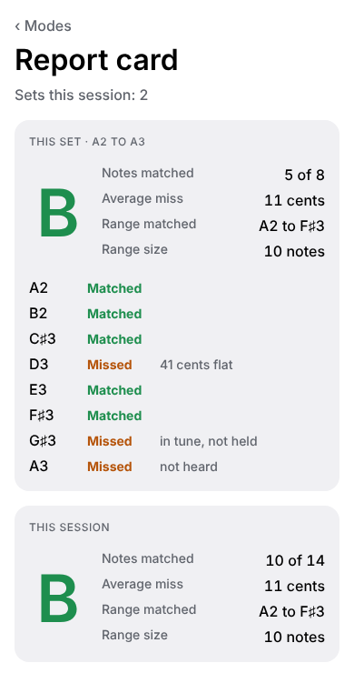

# Voice Coach

A singing coach for the phone. The aim: pick one song that challenges you, work on it every day, and get told exactly where your pitch is off.

Everything in the app is built from one move. The app plays a note for three seconds, then listens for 3.5 seconds while you sing it back. Hold the note in tune for two seconds and it counts as matched.



## Modes

| Mode | What it does | State |
| --- | --- | --- |
| Quick practice | One octave of a major scale, starting low, medium, high or top. Each note gets one attempt, then the next plays by itself. A report card follows, for the set and for the whole session, with a percent score and a letter grade. Then the scale can stay, or move down or up by one note or half an octave. | Built. Not yet run on a phone. |
| Progression | Ten guided levels. Level 1 finds your home note, the note you sing when asked for an easy one. Every later level is built from it. Levels train pitch matching, steps, jumps, range and breath control. Progress and achievements are saved on the phone. | Built. Not yet run on a phone. |
| Song mode | Master one song a phrase at a time, by call and response. | Design only. The screen explains the design. |

## Run it

```
npm install
npx expo start
```

Scan the QR code with an iPhone that has Expo Go. The computer and the phone must be signed in to the same Expo account and on the same Wi-Fi.

It needs a real phone. The microphone stream this app uses does not exist in the web version of `expo-audio`.

## Check it

```
node scripts/check.mts                          # all the logic, tested with made-up sound
node node_modules/typescript/bin/tsc --noEmit   # type check
```

Both must pass before any change counts as done.

The check builds every note from C2 to C6 as four kinds of tone (pure, voice-like, voice-like with hiss, and a weak fundamental) and requires each reading to land within 10 cents. The worst case today is 5.6 cents. A cent is one hundredth of a semitone. It then plays whole exercises, report cards and the progression path through with made-up singing.

## Layout

| Path | What it holds |
| --- | --- |
| `src/app/index.tsx` | The start screen: three modes |
| `src/app/quick.tsx`, `progression.tsx`, `song.tsx` | One screen per mode |
| `src/components/exercise-player.tsx` | Runs an exercise from first step to last: tone, listen, next tone |
| `src/components/run-view.tsx` | What a running exercise looks like: the note, the meter, the hold bar |
| `src/components/report-card.tsx` | A report card for one set or a whole session |
| `src/lib/exercise.ts` | The engine. An exercise is a list of steps; this is every way one can unfold. Pure logic. |
| `src/lib/quick.ts` | Quick practice: the scale, the starting notes, the shifts |
| `src/lib/progression.ts` | Progression: the levels, the pass marks, the achievements |
| `src/lib/report.ts` | What a list of results adds up to |
| `src/lib/pitch.ts` | Pitch detection (the YIN method) and smoothing. Pure maths. |
| `src/lib/notes.ts` | Notes, frequencies and cents. Pure maths. |
| `src/lib/frames.ts` | Regroups the microphone's buffers into even slices for the detector |
| `src/lib/hold.ts` | Compares a sung pitch with a note and counts how long it is held |
| `src/lib/melody.ts` | Turns a recording of one voice into a melody map: notes with start and end times |
| `src/lib/wav.ts` | Reads and writes WAV sound files |
| `src/hooks/use-pitch.ts` | The only file that touches the microphone. Plays the tone, then listens. |
| `src/hooks/tone-players.ts` | Keeps one sound player per reference tone |
| `src/hooks/use-progress.ts` | Saves progression progress on the phone |
| `src/data/tones.ts`, `assets/tones/` | Reference tones, one per note. Generated by `scripts/make-tones.mts`. |
| `scripts/melody.mts` | Command line: a WAV of one voice in, a melody map out |
| `scripts/check.mts` | Checks for everything under `src/lib` |

## Make a melody map

```
node scripts/melody.mts recording.wav map.json
```

The recording must be a WAV file of a voice on its own, with no instruments. The script prints each note with its start and end time and saves the map as JSON.

The check for this sings a made-up six-note phrase, with vibrato, a repeated note and two notes joined without a gap, and requires every note to come back in order with its edges within 70 milliseconds. It has not been tried on a real voice.

## Decisions

- **Expo and Expo Go.** Built on Windows, previewed on an iPhone, no Mac needed. `expo-audio` in SDK 58 can stream live microphone samples, which is what pitch detection needs.
- **Logic apart from the screen and the microphone.** Everything under `src/lib` is plain logic with no phone code, so it is tested on a computer with made-up sound.
- **One engine under every mode.** A scale, a level and a long hold are all lists of steps run by the same code.
- **Pitch detection is written here, not imported.** It is about a hundred lines, it is the heart of the app, and owning it means it can be tuned for singing.
- **Any octave counts.** A low voice can practice a note written for a high one. Reports still show the octave that was really sung.
- **Progression starts from the singer, not from a chart.** Finding a home note first means no one is asked their voice type.
- **The voice stays on the phone.** Sound is analyzed a slice at a time and thrown away. Nothing is recorded or sent anywhere.
- **The tone and the microphone never overlap.** On an iPhone, `expo-audio`'s microphone stream puts the phone in record-only mode, and nothing can play until the stream stops. Taking turns also keeps the app from scoring its own speaker. This is why Song mode is designed as call and response.
- **The speaker is reset before every tone.** The microphone stream leaves the phone in a quiet "measurement" setting, and a sound that has played once sits at its end. Both made the second tone silent on a real iPhone.
- **Reference tones are rich in overtones.** A phone speaker is silent below about 300 Hz, so a plain low note would not be heard.
- **Missed notes earn partial credit.** A matched note scores 100. A missed one gets up to 50 for how close the best attempt came (full marks on the note, nothing a semitone away) and up to 50 for how much of the hold was done in tune. The set's score is the average, graded on the school scale: A from 90, B from 80, C from 70, D from 60.
- **"One note" is one semitone**, the next piano key. That is how singers walk a warm-up scale up and down.
- **Round timings came from trying it** (Matthew, 2026-11-16): a 3 second tone, 3.5 seconds of listening, 2 seconds held.

## Not yet proven

These need a real iPhone and have not been tried:

1. That the tone plays on every round. It was silent after the first round on 2026-11-16. The fix has not been confirmed.
2. The start screen, Quick practice and Progression. They were built after the last phone test. The screens were looked at in a browser, where the microphone does not work.
3. How accurate the detector is on a real voice. It shows a note for one, but nobody has checked the note is right.
4. That progress is still there after the app is closed and opened again.
5. `npx expo lint` has never run. The linter would not install in the build environment.

## Roadmap

1. **Prove this build on a phone.** The five items above.
2. **Song mode.** In order: score a sung phrase against a melody map, play a phrase as one sound, try the melody script on a real voice, then find a way to lift the voice out of a full song. The last one is not researched and decides which songs can be used.
3. **More of Progression.** Slides across the bridge, loud and soft on one note, and short phrases from real songs. Slides need a new kind of step that scores a moving pitch.

Songs from streaming services cannot be analyzed, because their playback is protected. The first route is songs owned as files. Selling an app built on the melodies of commercial songs would likely need the rights cleared first; personal use does not.
