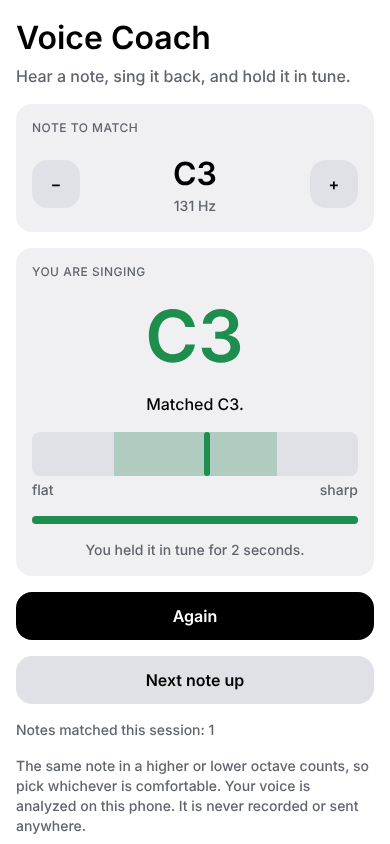

# Voice Coach

A singing coach for the phone. The aim: pick one song that challenges you, work on it every day, and get told exactly where your pitch is off.

This first version does the smallest useful piece of that. It plays a note, listens while you sing it back, and shows how close you are. Hold the note in tune for two seconds to match it.



## Run it

```
npm install
npx expo start
```

Scan the QR code with an iPhone that has Expo Go. The computer and the phone must be signed in to the same Expo account and on the same Wi-Fi.

It needs a real phone. The microphone stream this app uses does not exist in the web version of `expo-audio`.

## Check it

```
node scripts/check.mts                          # the pitch engine, tested with made-up sound
node node_modules/typescript/bin/tsc --noEmit   # type check
```

Both must pass before any change counts as done.

The engine check builds every note from C2 to C6 as four kinds of tone (pure, voice-like, voice-like with hiss, and a weak fundamental) and requires each reading to land within 10 cents. The worst case today is 5.6 cents. A cent is one hundredth of a semitone.

## Layout

| Path | What it holds |
| --- | --- |
| `src/app/index.tsx` | The one screen: note to match, what you are singing, the meter |
| `src/lib/pitch.ts` | Pitch detection (the YIN method) and smoothing. Pure maths. |
| `src/lib/notes.ts` | Notes, frequencies and cents. Pure maths. |
| `src/lib/frames.ts` | Regroups the microphone's buffers into even slices for the detector |
| `src/lib/hold.ts` | Compares a sung pitch with a target and counts how long it is held |
| `src/lib/practice.ts` | The state of a practice session and every way it can change |
| `src/lib/melody.ts` | Turns a recording of one voice into a melody map: notes with start and end times |
| `src/lib/wav.ts` | Reads and writes WAV sound files |
| `src/hooks/use-pitch.ts` | The only file that touches the microphone |
| `src/data/tones.ts`, `assets/tones/` | Reference tones, one per note. Generated by `scripts/make-tones.mts`. |
| `scripts/melody.mts` | Command line: a WAV of one voice in, a melody map out |
| `scripts/check.mts` | Checks for everything under `src/lib` |

## Make a melody map

```
node scripts/melody.mts recording.wav map.json
```

The recording must be a WAV file of a voice on its own, with no instruments. The script prints each note with its start and end time and saves the map as JSON.

The check for this sings a made-up six-note phrase, with vibrato, a repeated note and two notes joined without a gap, and requires every note to come back in order with its edges within 70 milliseconds. It has not been tried on a real voice.

## Decisions

- **Expo and Expo Go.** Built on Windows, previewed on an iPhone, no Mac needed. `expo-audio` in SDK 58 can stream live microphone samples, which is what pitch detection needs.
- **Logic apart from the screen and the microphone.** Everything under `src/lib` is plain maths with no phone code, so it is tested on a computer with made-up sound.
- **Pitch detection is written here, not imported.** It is about a hundred lines, it is the heart of the app, and owning it means it can be tuned for singing.
- **Any octave counts.** A low voice can practise a note written for a high one.
- **The voice stays on the phone.** Sound is analyzed a slice at a time and thrown away. Nothing is recorded or sent anywhere.
- **The microphone turns off while the reference tone plays.** On an iPhone, `expo-audio`'s microphone stream puts the phone in record-only mode, and nothing can play until the stream stops. Pausing it also keeps the app from scoring its own speaker.
- **Reference tones are rich in overtones.** A phone speaker is silent below about 300 Hz, so a plain low note would not be heard.

## Not yet proven

These need a real iPhone and have not been tried:

1. That the microphone stream works inside Expo Go. The Expo documentation lists `expo-audio` as included in Expo Go but says nothing specific about streaming.
2. That the reference tone can be heard. The first build was silent on a real iPhone (2026-11-16). The fix has not been confirmed yet.
3. How the detector does on a real voice, as opposed to made-up tones.
4. `npx expo lint` has never run. The linter would not install in the build environment.

## Roadmap

1. **Prove the microphone path on a phone.** The four items above.
2. **A melody map for one song.** Take a song file the user owns, pull out the sung melody, and store it as a list of notes and times. This is the hard part of the whole project.
   - Done: turning a voice on its own into a map (`scripts/melody.mts`), checked with made-up singing.
   - Next: try it on a real voice.
   - Open: separating the voice from the instruments in a full song. Not researched yet.
3. **Sing along to the map.** Scroll the song's melody past a marker and score the voice against it, phrase by phrase.
4. **Daily practice on one song.** Find the phrases that go wrong most and turn them into exercises.

Songs from streaming services cannot be analyzed, because their playback is protected. The first route is songs owned as files. Selling an app built on the melodies of commercial songs would likely need the rights cleared first; personal use does not.
